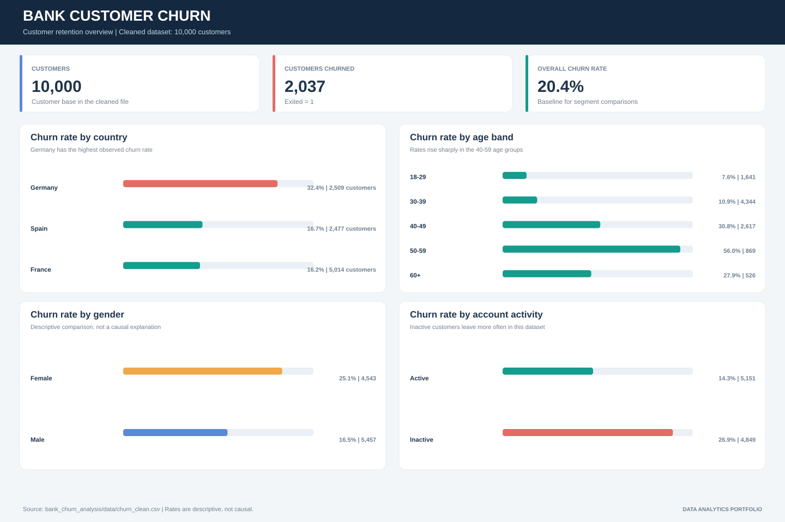
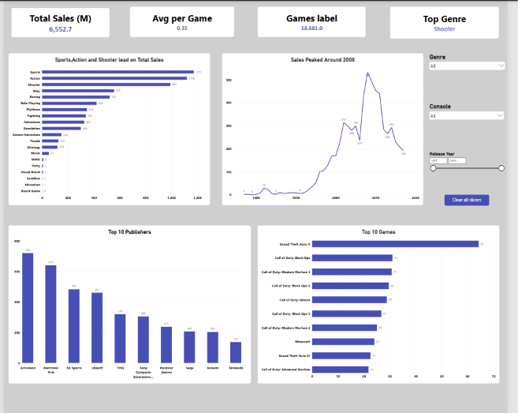
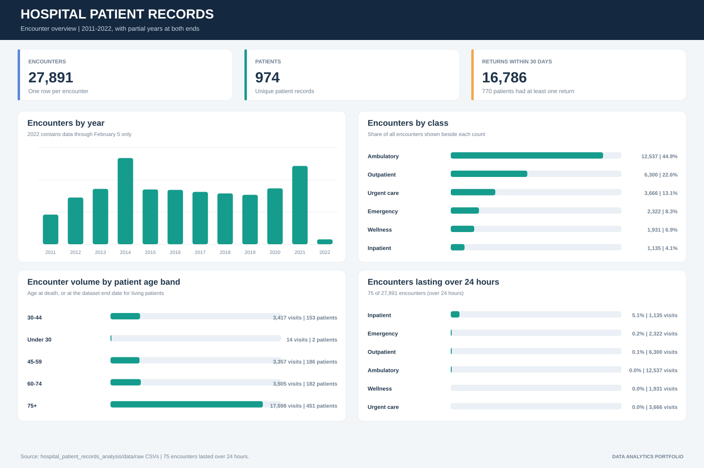

# Data Analytics Portfolio

Hi, I'm **Lynn Njeri Nderitu**, a data analyst based in Nairobi, Kenya. I have a degree in Actuarial Science and I use SQL at work to retrieve and analyse client data. This repository holds my end-to-end analysis projects, where I take messy data, clean it with SQL, find answers to business questions, and present them in Power BI dashboards.

**Skills shown here:** SQL (data cleaning, views, joins, aggregations) | Power BI (interactive dashboards) | Data cleaning and validation | Business analysis and recommendations

---

## Projects

### 1. Bank Customer Churn Analysis
[View project](bank_churn_analysis/)

**Question:** Which customers are most likely to leave a bank, and what do they have in common?

**Tools:** SQL, Power BI

**Highlights:**
- Cleaned a messy 10,000-customer dataset (duplicates, inconsistent country names, placeholder values) using SQL views, without editing the raw tables.
- 20.4% of customers left. Germany churns about twice as much as France or Spain.
- The highest-risk group is inactive customers aged 50 and over, with churn of roughly 78% to 89%.
- Created two dashboard-style SVG visual previews with recommendations for retention.

---

### 2. Video Game Sales Analysis
[View project](video-game-sales-analysis/)

**Question:** Which genres, platforms and publishers drive global video game sales, and how do tastes differ by region?

**Tools:** SQL, Power BI

**Highlights:**
- Cleaned and analysed more than 64,000 game records, removing 225 duplicates and handling missing sales figures correctly (blank is not zero).
- Reduced the data to 18,681 usable titles through documented rules held in one SQL view.
- Built a three-page Power BI dashboard covering genres, platforms, publishers, regional differences and critic scores.

---

### 3. Hospital Patient Records Analysis
[View project](hospital_patient_records_analysis/)

**Question:** What do hospital encounter patterns, procedure costs, payer coverage and 30-day returns look like?

**Tools:** SQL (MySQL)

**Highlights:**
- Validated 974 patients, 27,891 encounters, 47,701 procedures, 10 payers and one organization.
- Created clean patient, encounter and procedure views while preserving the original tables.
- Analysed encounter trends, costs, coverage and patient returns, with two dashboard-style SVG previews.

---

## How each project is organised

Each project folder follows the same structure:

| Folder / file | Contents |
|---|---|
| `README.md` | Business problem, questions, data, cleaning steps, findings, recommendations and limitations |
| `sql/` | Cleaning and analysis scripts |
| `powerbi/` | Power BI dashboard file |
| `images/` | Dashboard screenshots |
| `data/` | Source data, or instructions to get it |

## Data sources

The datasets come from the [Maven Analytics Data Playground](https://mavenanalytics.io/data-playground), a free source of practice datasets. Each project README names its dataset.

## About me

- Frontend developer (Vue, Nuxt) with hands-on SQL experience retrieving client data in a customer-facing business.
- Looking for a data analyst role.

## Contact

- Email: [lynnnderitu612@gmail.com]
- LinkedIn: [your LinkedIn link]
- GitHub: [github.com/lynn688](https://github.com/lynn688)