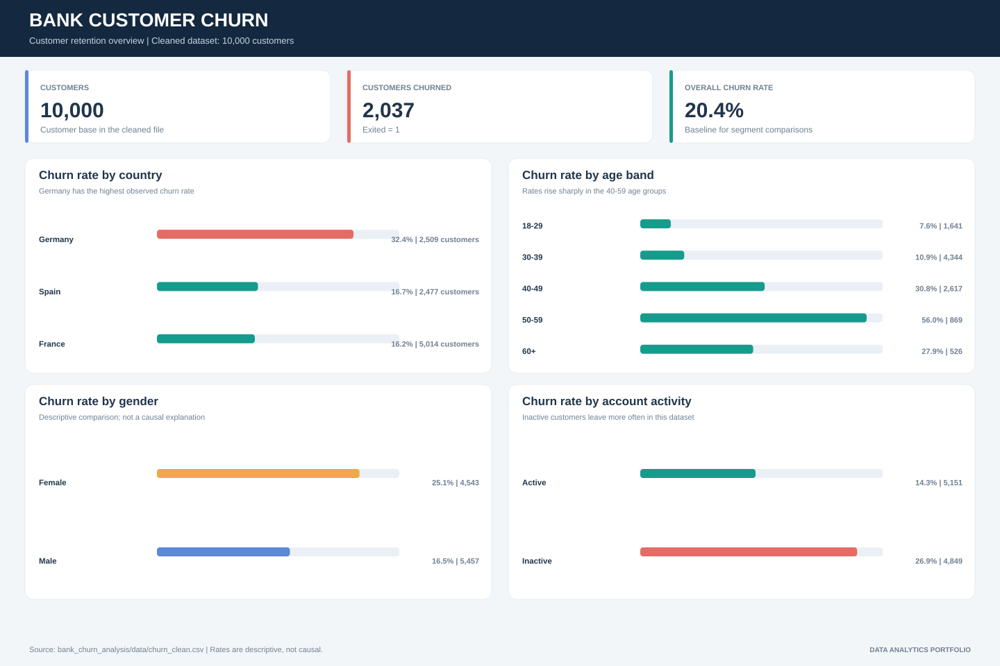
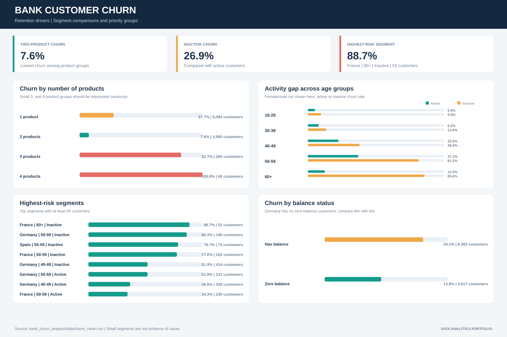

# Bank Customer Churn Analysis

An analysis of 10,000 bank customers to find out who is leaving and what they have in common. Data was cleaned and analysed with SQL (MySQL). Dashboard-style SVG previews summarize the findings; they are not screenshots exported from Power BI.



## Business Problem

Keeping an existing customer costs far less than winning a new one, so a bank wants to know which customers are most likely to leave. This project looks at a customer base where 20% of customers have already left, and asks which groups are most at risk and which factors the bank could act on.

## Business Questions

1. How many customers does the bank lose, and what is the baseline churn rate?
2. Which countries lose the most customers?
3. How do age and gender relate to churn?
4. Do customers with more products, or more active customers, stay longer?
5. Do balance, credit score, salary or tenure make a difference?
6. Which groups of customers are at the highest risk?

## Data

- **Source:** [https://mavenanalytics.io/data-playground/bank-customer-churn]
- **Size:** 10,000 customers
- **Files:** a messy Excel workbook with two sheets (`Customer_Info`, `Account_Info`), a clean CSV version of the same data, and a data dictionary
- **Key columns:** customer ID, geography, gender, age, tenure, balance, number of products, active member flag, estimated salary, credit score, and `Exited` (1 = the customer left)

I worked from the messy workbook, which gave me real cleaning work to do. The clean CSV was used only to check my results.

## Tools

SQL (MySQL), Power BI, VS Code.

## Data Cleaning

The raw tables were never edited. All cleaning is done in SQL views, in [`sql/cleaning.sql`].

| Problem found | What I did |
|---|---|
| Duplicate customers (1 in the customer sheet, 2 in the account sheet) | Kept one row per customer ID before joining |
| France written three ways (France, French, FRA) | Standardised to France |
| Salary and balance stored as text with a € symbol | Removed the symbol and converted to numbers |
| 3 customers with a placeholder salary of −€999,999, and missing age and surname | Converted the placeholder to NULL, kept the customers and flagged them |
| Yes/No text in the active member column | Converted to 1/0 |
| Credit card column identical to the active member column in every row | Excluded it from the analysis |
| Two sheets | Joined on customer ID after removing duplicates |

I added grouping columns for age, credit score and balance, and checked the result: 10,000 unique customers, 2,037 customers who left, and averages that match the clean file.

## Key Findings

- **20.4% of customers left** (2,037 of 10,000).
- **Germany churns about twice as much as France or Spain** (32.4% against 16.2% and 16.7%). Germany has no zero-balance customers, but the gap remains when only customers with a balance are compared, so balance does not explain it.
- **Age is a strong factor.** Churn is low under 40 (7.6% and 10.9%), rises to 30.8% at 40 to 49, and peaks at 56.0% for customers aged 50 to 59.
- **Women churn more than men** (25.1% against 16.5%), and the gap holds in every age group.
- **Customers with two products are the most loyal** (7.6% churn). Customers with one product churn at 27.7%. Churn is extreme for customers with three or four products (82.7% and 100%), but there are only 266 and 60 of them.
- **Inactive members churn at 26.9%**, against 14.3% for active members.
- **Credit score, salary and tenure make little difference.**
- **The highest-risk group is inactive customers aged 50 and over**, with churn of roughly 78% to 89% in all three countries.
- On average, customers who left are older (44.8 against 37.4 years) and hold higher balances (about 91,000 against 73,000).

## Recommendations

- Focus retention work on **inactive customers aged 50 and over**, the group most likely to leave.
- **Investigate the German market.** Churn there is double the rest, and the cause is not in this data.
- **Encourage inactive customers to re-engage** and look at why customers with a single product are three to four times as likely to leave as those with two.
- Review the **three and four product bundles**, where almost everyone leaves, although the groups are small.

## Limitations

- This shows patterns, not causes. The data cannot say why customers left.
- The credit card column was unreliable in the messy file and was excluded.
- Three customers have no age or salary. They are kept and flagged.
- The three and four product groups are small (266 and 60 customers), so their rates should be treated carefully.

## Dashboard-style Visuals

The visual design has two pages:

| Page | Contents |
|---|---|
| Overview | Customers, customers who left and churn rate, with churn by country, age group, gender and activity |
| Drivers | Churn by number of products, a country by age heatmap, the profile of customers who left, and the highest-risk groups |




## Project Structure

```
bank_churn_analysis/
├── data/
│   ├── Bank_Churn_Messy.xlsx
│   ├── Bank_Churn.csv
│   ├── Bank_Churn_Data_Dictionary.csv
│   └── churn_clean.csv
├── sql/
│   ├── cleaning.sql
│   └── analysis.sql
├── images/
│   ├── dashboard_overview.svg
│   └── drivers.svg
└── README.md
```

## How to Reproduce

1. Load the two sheets of `Bank_Churn_Messy.xlsx` into MySQL as `churn_data` and `churn_messy`.
2. Run `sql/cleaning.sql`, then `sql/analysis.sql`.
3. View the dashboard-style visuals in `images/`; they are generated from `data/churn_clean.csv`.

