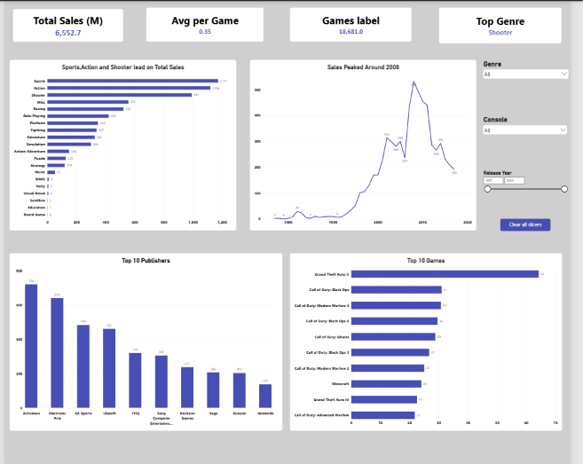
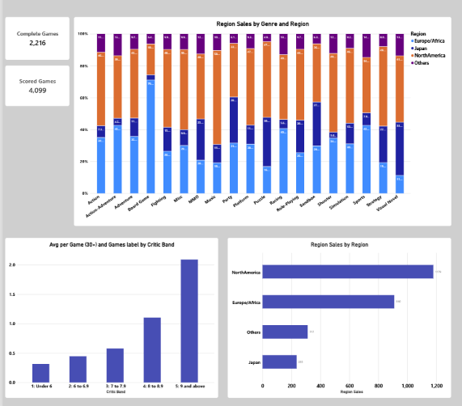
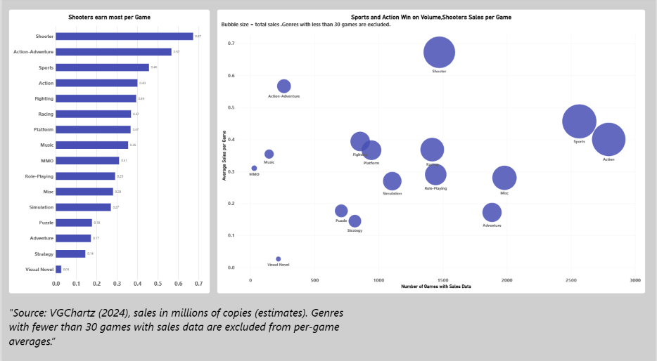

# Video Game Sales Analysis

An end-to-end analysis of more than 64,000 video games to understand which genres, platforms and publishers drive global sales, and how player tastes differ across regions. Data was cleaned and analyzed with SQL (SQLite) and visualized in an interactive three-page Power BI dashboard.



## Business Problem

The video game industry is expensive to enter. A single title can cost millions to develop, and publishers have to decide which genres to back, which platforms to release on, and which markets to target. This project uses historical sales data to answer those questions, so that a publisher, studio or investor can see where demand has been and make better informed decisions.

## Business Questions

1. **Genres and platforms:** Which genres and platforms generate the most global sales?
2. **Trends over time:** How have video game sales changed over the years?
3. **Regional differences:** How do tastes differ between North America, Japan, Europe/Africa and the rest of the world?
4. **Publishers:** Which publishers sell the most, and how concentrated is the market?
5. **Critic scores:** Do games with higher critic scores sell more copies?
6. **Best sellers:** Which individual games are the best-selling of all time?

## Data

- **Source:** VGChartz, 2024 data set (add the link to where you downloaded it)
- **Size:** 64,016 rows and 14 columns
- **Key columns:** title, console, genre, publisher, developer, critic score, sales by region (North America, Japan, Europe/Africa, rest of world), total sales, release date
- **Units:** sales are in millions of copies
- **Important:** sales figures are VGChartz **estimates**, not official numbers

## Tools

SQL (SQLite) for cleaning and analysis, Power BI for visualization, VS Code.

## Data Cleaning

The original table (`vgchartz-2024`) was never modified. All cleaning produced new tables and a view. The full script is in [`sql/cleaning.sql`].

| Step | What I did | Why | Rows affected |
|---|---|---|---|
| 1 | Dropped `img` and `last_update` | No analytical value | 2 columns |
| 2 | Converted the placeholder "Unknown" to NULL in publisher and developer | So "Unknown" does not rank as a top publisher | 8,842 publishers, 4,435 developers |
| 3 | Extracted `release_year` from the text date | Needed for trend analysis | All rows |
| 4 | Flagged titles that are regional sales notes, e.g. "Mortal Kombat II (US sales)" | They are partial entries of games listed elsewhere, so counting them would double count sales | About 185 |
| 5 | Flagged games released after the data was collected (June 2024) | Scheduled releases with no real sales | 5 |
| 6 | Removed duplicates (same title on the same console), keeping the most complete row | Prevent counting a game twice | 225 removed |
| 7 | Created the view `sales_analysis`: games with sales data, not partial records, not future releases | One place that holds the rules for every sales query | 18,681 remain |

**Row counts:** 64,016 raw, then 63,791 after removing duplicates, then 18,681 usable for sales analysis.

**Key decisions**

- **Blank is not zero.** Missing regional and total sales were kept as NULL, because a blank means "not reported", not "none sold". About 70% of games have no sales figure, so all sales analysis uses the 18,681 games that do.
- **Flag, don't delete.** Partial records and future releases were flagged and excluded from sales queries, but kept in the clean table so nothing is lost.
- **Impact check.** After filtering, total sales fell from 6,605.9M to 6,552.7M, a change of less than 1%, so these decisions do not materially change the results.
- **Minimum sample size.** Per-game genre averages only include genres with at least 30 games. Without this rule, Sandbox ranks first because it contains a single game (Minecraft).

## Analysis

All queries are in [`sql/analysis.sql`], one per business question.

## Key Findings

**1. Sports, Action and Shooter lead on total sales, but Shooters earn the most per game.**
Sports (1,171M), Action (1,118M) and Shooter (991M) together account for about half of all recorded sales. Per game, Shooter leads with 0.67M copies, ahead of Action-Adventure (0.57M), Sports (0.46M) and Action (0.40M). The PS2 is the best-selling platform, with 1,008M copies.

**2. Sales grew through the 1990s and 2000s and peaked around 2008.**
Annual sales reached about 532M copies in 2008. The data effectively stops recording sales after 2018, so the drop after that reflects missing data, not a collapse in the market.

**3. North America and Europe/Africa dominate, and Japan has distinct tastes.**
Among the 2,216 games with all four regions reported, North America accounts for 44.7% of sales, Europe/Africa 34.5%, the rest of the world 11.8% and Japan 8.9%. Japan's share is highest in Puzzle (about 31%) and Role-Playing (about 20%), and only about 4% for Shooters.

**4. A few publishers hold most of the market.**
Activision (720M) and Electronic Arts (639M) lead, and the top ten publishers hold about 57% of sales. Rockstar Games has only 91 games but the highest average, at 2.6M copies per game.

**5. Higher critic scores go with higher sales.**
Average sales per game rise steadily across score bands: 0.32M for games under 6, 0.58M for 7 to 7.9, 1.10M for 8 to 8.9, and 2.09M for 9 and above. This is a relationship, not proof that good reviews cause sales. Big-budget games may simply receive both better reviews and larger audiences.

**6. Grand Theft Auto V is the best-selling game by a wide margin.**
Across its four platforms, GTA V sold about 64.3M copies, roughly double the next game (Call of Duty: Black Ops, 31.0M). Call of Duty titles fill much of the rest of the top ten.

## Recommendations

- **Prioritize Shooters and Action-Adventure** for the strongest sales per title, while recognizing that Sports and Action offer the largest total market.
- **Treat Japan as a separate market.** Its tastes lean toward Puzzle and Role-Playing games, and a strategy built for North America and Europe is unlikely to transfer.
- **Invest in quality.** Games with higher critic scores sell far more on average, so review quality is a signal worth tracking, even though it does not prove cause.
- **Expect market concentration.** With the top ten publishers holding about 57% of sales, new entrants may do better in niches than in head-on competition.

## Limitations

- About 70% of games have no sales figure, and about 78% have no critic score, so those analyses use smaller samples (18,681 and 4,099 games).
- Sales are VGChartz estimates, and sales data is effectively missing after 2018.
- Regional comparisons use only the 2,216 games with all four regions reported. These skew toward larger titles (1.19M copies per game versus 0.35M overall), so the regional split is indicative rather than exact.
- "EA Sports" is listed as a separate publisher from Electronic Arts, which understates EA's combined total.
- When duplicates were removed, only one row per game and console was kept, which may drop a small amount of sales information.
- The year filter in the dashboard excludes the 85 games with no release date.

## Dashboard

The Power BI dashboard has three pages.

| Page | Contents |
|---|---|
| Overview | KPI cards, sales by genre, sales by year, top 10 publishers, top 10 games, slicers for genre, console and release year |
| Regions and Critic Scores | Sales by region, regional share by genre, average sales by critic score band |
| Genre Deep Dive | Average sales per game by genre, volume versus sales per game |





## Project Structure

```
video-game-sales-analysis/
├── data/
│   ├── raw/
│   │   ├── vgchartz-2024.csv
│   │   └── vg_data_dictionary.csv
│   └── cleaned/
│       └── sales_analysis.csv
├── sql/
│   ├── 01_cleaning.sql
│   └── 02_analysis.sql
├── powerbi/
│   └── video_game_dashboard.pbix
├── images/
├── video_games.db
└── README.md
```

## How to Reproduce

1. Open `video_games.db` in any SQLite client. It contains the untouched raw table `vgchartz-2024.csv`.
2. Run `sql/cleaning.sql` to build the clean table and the analysis view.
3. Run the queries in `sql/analysis.sql`.
4. Open `powerbi/video_game_dashboard.pbix`. It loads `data/cleaned/sales_analysis.csv`.

## About Me

Your name | [LinkedIn](#) | your.email@example.com